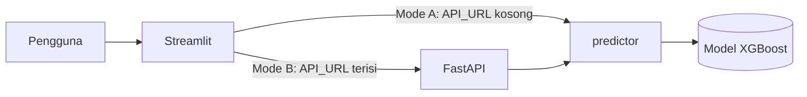

# ⚙️ Predictive Maintenance: Remaining Useful Life (RUL) Motor Induksi

Aplikasi web yang memperkirakan **sisa umur pakai (RUL, dalam jam)** motor induksi industri dari
empat sensor operasional, lalu menampilkan status perawatan (Prima / Normal / Perhatian / Kritis).
Model: **XGBoost Regressor**. Antarmuka: **Streamlit**. API opsional: **FastAPI**.

> 🔗 **Demo online:** [ISI LINK STREAMLIT DI SINI](https://namaapp.streamlit.app)
> 🎥 **Video demo:** [ISI LINK VIDEO DI SINI]()

---

## 📌 Ringkasan

| | |
|---|---|
| **Tugas** | Regresi: memprediksi `sisa_umur_jam` |
| **Input** | Arus (A), getaran (mm/s), suhu body (°C), tegangan (V) |
| **Output** | Estimasi sisa umur (jam) + status perawatan |
| **Model** | XGBoost dalam pipeline *pembersihan → imputasi median → XGBoost* |
| **Pengguna** | Teknisi dan perencana perawatan pabrik |
| **Mata kuliah** | Mekatronika dan Kecerdasan Buatan (MKB), Studi Kasus 03 |

## ✨ Fitur

- Form input sensor dengan hasil berwarna sesuai status perawatan
- Tampilan JSON input dan output untuk transparansi
- Prediksi massal lewat unggah CSV
- Validasi input (nilai di luar rentang ditolak)
- Penanganan sensor error: nilai negatif pada arus/getaran dianggap rusak lalu diimputasi median
- REST API (`/predict`, `/health`, dokumentasi otomatis di `/docs`)
- Dua mode penyajian dengan kode prediksi yang sama

## 🏗️ Arsitektur

Kode prediksi (`src/predictor.py`) dipakai bersama oleh UI dan API. Anda bebas memilih jalurnya:



- **Mode A** (dipakai untuk deploy): `Pengguna → Streamlit → predictor → model`. Satu proses, cocok untuk Streamlit Community Cloud.
- **Mode B** (demo lokal): `Pengguna → Streamlit → FastAPI → predictor → model`. UI dan API berjalan terpisah lewat HTTP + JSON, sehingga aplikasi lain bisa memakai modelnya.

## 📊 Status perawatan

| Sisa umur (jam) | Status | Arti |
|---|---|---|
| > 500 | ✅ PRIMA | Kondisi baik |
| 101 – 500 | 🆗 NORMAL | Pantau berkala |
| 25 – 100 | ⚠️ PERHATIAN | Jadwalkan servis |
| ≤ 24 | 🚨 KRITIS | Hentikan operasi |

## 📥 Input yang diterima

| Kolom | Satuan | Rentang valid |
|---|---|---|
| `arus_ampere` | A | 0 – 100 |
| `getaran_mm_s` | mm/s | 0 – 50 |
| `suhu_body_c` | °C | 0 – 200 |
| `tegangan_volt` | V | 0 – 500 |

Nilai di luar rentang ditolak dengan kode **422**. Itu validasi yang bekerja, bukan bug.

## 🚀 Cara menjalankan (Windows, PowerShell)

Butuh **Python 3.12 atau 3.13** resmi dari python.org (hindari 3.14 dan versi MSYS/MinGW).
Jalankan dari **root repo** (folder yang berisi `requirements.txt`).

```powershell
python -m venv .venv
Set-ExecutionPolicy -Scope Process -ExecutionPolicy Bypass   # hanya untuk sesi terminal ini
.\.venv\Scripts\Activate.ps1
pip install -r requirements.txt
```

Mac/Linux: `python3 -m venv .venv && source .venv/bin/activate && pip install -r requirements.txt`.

### Mode A: aplikasi saja

```powershell
python -m streamlit run app/ui/streamlit_app.py
```

Buka `http://localhost:8501`.

### Mode B: UI memanggil API

Dua terminal, aktifkan `.venv` di keduanya.

```powershell
# Terminal 1: API
python -m uvicorn app.api.main:app --port 8000

# Terminal 2: UI
$env:API_URL = "http://127.0.0.1:8000"
python -m streamlit run app/ui/streamlit_app.py
```

Dokumentasi interaktif API: `http://127.0.0.1:8000/docs`.

### Uji cepat (normal, ekstrem, invalid)

```powershell
python -m tests.smoke_test
```

## 🔌 Contoh pemakaian API

**Permintaan**

```bash
curl -X POST http://127.0.0.1:8000/predict \
  -H "Content-Type: application/json" \
  -d '{"arus_ampere": 12.5, "getaran_mm_s": 2.1, "suhu_body_c": 45, "tegangan_volt": 220}'
```

**Respons 200**

```json
{
  "status": "PRIMA",
  "remaining_useful_life_hours": 1919.78,
  "latency_ms": 4.4
}
```

**Respons 422** (misalnya `arus_ampere: -5`): berisi field `detail` yang menjelaskan input mana yang salah.

**Cek kesehatan:** `GET /health` → `{"status": "ok", "model_loaded": true}`

## 📁 Struktur repo

```
.
├── app/
│   ├── api/main.py              FastAPI (/health, /predict, /docs)
│   └── ui/streamlit_app.py      UI Streamlit (Mode A / Mode B, upload CSV)
├── src/
│   ├── features.py              daftar fitur + bersihkan_data
│   └── predictor.py             muat model, prediksi, penentuan status
├── artifacts/
│   ├── xgb_rul.json             booster XGBoost (format JSON, lintas platform)
│   ├── imputer_rul.joblib       imputer median
│   ├── model_rul.joblib         model pipeline asli (cadangan)
│   └── metadata.json            fitur, metrik, versi library
├── data/dataset_motor_induksi_rul.csv
├── tests/smoke_test.py          uji normal / ekstrem / invalid
├── train_rul_model.ipynb        notebook training (VS Code atau Colab)
└── requirements.txt             versi library dipatok
```

## 🧠 Model dan pelatihan

Pelatihan dilakukan lewat **`train_rul_model.ipynb`** (bisa dijalankan di VS Code maupun Google Colab).

1. Muat `data/dataset_motor_induksi_rul.csv`, lakukan EDA, dan bersihkan sensor error.
2. Latih pipeline: `bersihkan_data → SimpleImputer(median) → XGBRegressor(n_estimators=300, learning_rate=0.05, max_depth=5)`.
3. Bandingkan dengan **baseline** (rata-rata) pada test set 20%.
4. Simpan model portabel: `xgb_rul.json`, `imputer_rul.joblib`, `metadata.json`.

Model disimpan sebagai **JSON XGBoost**, bukan pickle seluruh pipeline, karena pickle XGBoost bisa gagal dibaca di komputer atau versi lain (`XGBoostError: input stream corrupted`).

Hasil evaluasi (isi dari output notebook):

| Metrik | Model | Baseline |
|---|---|---|
| MAE (jam) | [isi] | [isi] |
| RMSE (jam) | [isi] | – |
| R² | [isi] | – |

> Isi tabel ini dengan angka dari notebook Anda. Model harus mengalahkan baseline pada test set.

## ⚠️ Keterbatasan

- Dataset yang tersedia di repo berukuran kecil dan/atau sintetis, sehingga metrik belum mencerminkan performa di lapangan.
- Model hanya akurat pada rentang kondisi yang ada di data latih. Pada input ekstrem di luar pola data latih (misalnya arus 20 A, getaran 12 mm/s, suhu 95 °C), prediksi bisa terlalu optimis. Contoh: model asli memberi sekitar 121,8 jam (Normal) untuk kombinasi tersebut.
- Batas validasi input dan ambang status (500 / 100 / 24 jam) belum dikalibrasi dengan data perawatan nyata.
- Hanya data tabular dan antarmuka web; belum ada penyimpanan riwayat prediksi.

## 🌐 Deploy (Streamlit Community Cloud)

1. Push repo ke GitHub, pastikan seluruh isi `artifacts/` ikut ter-commit.
2. Di [share.streamlit.io](https://share.streamlit.io) pilih **Create app**, lalu repo ini, branch `main`.
3. Main file path: `app/ui/streamlit_app.py`. Python: 3.12 atau 3.13. Biarkan secrets dan `API_URL` kosong (Mode A).
4. **Deploy**, lalu uji dengan input normal, ekstrem, dan invalid.

## 🧯 Masalah umum

| Gejala | Penyebab dan solusi |
|---|---|
| `Activate.ps1` tidak bisa dijalankan | Jalankan `Set-ExecutionPolicy -Scope Process -ExecutionPolicy Bypass` |
| `No module named 'src'` | Jalankan dari root repo (folder yang berisi `requirements.txt`) |
| `XGBoostError: input stream corrupted` | Pastikan `artifacts/xgb_rul.json` dan `imputer_rul.joblib` ada; loader memprioritaskan keduanya |
| `422 Unprocessable Entity` | Input di luar rentang; baca field `detail` |
| Streamlit Cloud: model tidak ditemukan | Berkas `artifacts/` belum ter-commit; cek `.gitignore` |
| Error versi library | Pasang persis seperti `requirements.txt` dan pakai Python 3.12/3.13 |

## 🛠️ Teknologi

`xgboost` · `scikit-learn` · `pandas` · `numpy` · `joblib` · `fastapi` · `uvicorn` · `pydantic` · `streamlit`

## 👨‍💻 Pengembang

- **Nama:** Iqbal Ianudin
- **NIM:** [isi NIM]
- **Mata kuliah:** Mekatronika dan Kecerdasan Buatan (MKB)
